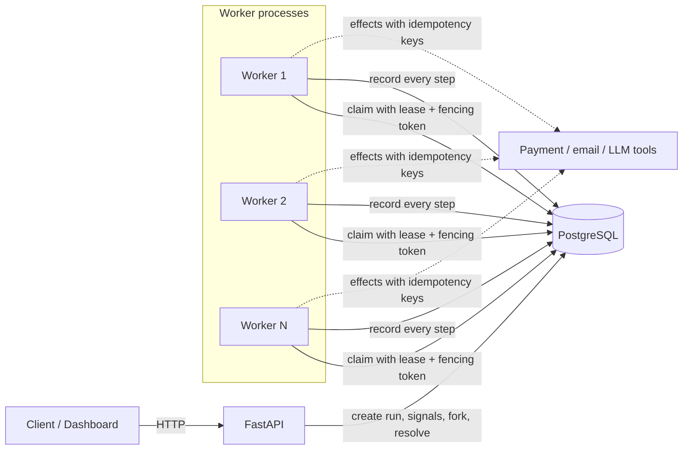

# Architecture

**PostgreSQL is the only shared state.** There is no broker, no coordinator process and no in-memory state
that matters: a worker can be killed at any instruction and another one continues from the log.

## The four ideas

1. **Event sourcing.** A run is its append-only list of events. Current state is derived, never trusted.
2. **Deterministic replay.** Workflow code is re-run from the top after any interruption. Completed steps return
   their recorded results; time, randomness and LLM answers are recorded, so the code takes the same path.
3. **Leases and fencing.** A worker owns a run only while it renews a lease. Every database write carries the
   worker's fencing token; a worker that was frozen and comes back is rejected by the database.
4. **Idempotent effects.** Real-world calls carry a key `<run_id>:<step>`, so a retry after a crash returns the
   original result instead of acting twice. Where a provider cannot dedupe, a verify hook or a human decides.

## Run states

`PENDING -> RUNNING -> COMPLETED | FAILED`, with `WAITING` (timer or signal), `NEEDS_REVIEW` (outcome unknown)
and back to `RUNNING`. See [workflow-lifecycle.md](workflow-lifecycle.md).

## Where each concern lives

| Concern | Code | Doc |
|---|---|---|
| Workflow API (`ctx.step/effect/llm/sleep/wait_for_signal`) | `app/sdk/context.py` | replay-and-recovery.md |
| Recording and fencing | `app/engine/execution_context.py` | workers-and-leases.md |
| Replay | `app/engine/replay.py` | replay-and-recovery.md |
| Idempotency, unknown outcomes | `app/engine/runtime.py`, `app/integrations/tools` | idempotency.md |
| Claiming, leases, heartbeat | `app/database/repositories.py`, `app/engine/worker.py` | workers-and-leases.md |
| Timers and signals | `app/engine/timers.py`, `signals.py` | timers-and-signals.md |
| Fork and diff | `app/engine/forks.py` | forking-and-diff.md |
| Outage handling | `app/engine/runtime.py`, `worker.py` | chaos-testing.md |
| Dashboard (plain HTML + JS, no build step, served at `/dashboard`) | `app/static/dashboard.html` | this file |

## What it is not

Not a replacement for Temporal or a production job system: one PostgreSQL instance is the throughput and
availability ceiling, timers are accurate to the poll interval, long histories replay in full (no snapshots),
and the guarantee is at-least-once with idempotent effects, never "exactly-once".
