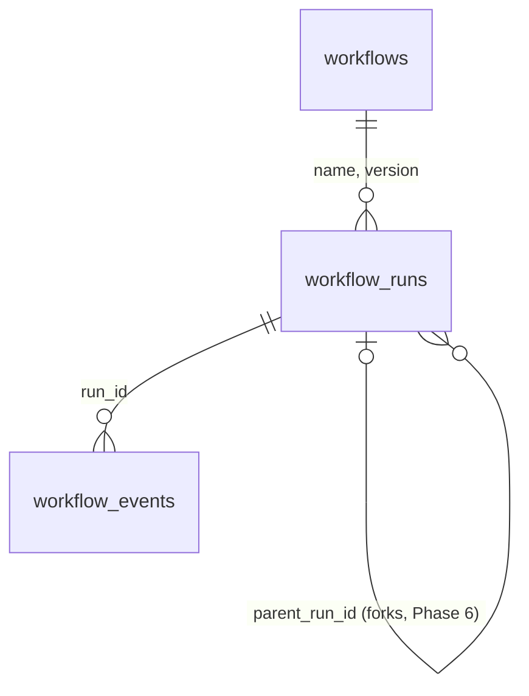

# Database design (Phase 1)

PostgreSQL is the source of truth for execution history. Nothing durable lives in Python memory.

## Tables

| Table | Purpose |
|---|---|
| `workflows` | Registered definitions. Primary key `(name, version)`, so a run always points at the exact version of the code it used. |
| `workflow_runs` | One row per execution: status, JSON input, JSON result, current step, error message, timestamps, `parent_run_id`, and the lease: `lease_owner`, `lease_expires_at`, `fencing_token` (+1 on every claim). |
| `workflow_events` | The append-only history. One row per thing that happened. |
| `idempotency_records` | One row per external operation, keyed by idempotency key: status (`IN_FLIGHT`, `SUCCEEDED`, `RECONCILED`, `FAILED`, `UNKNOWN`), attempts and result. Updated in the same transaction as the matching event. |

| `workers` | Informational registry of worker processes (id, host, pid, status, last heartbeat). Nothing depends on it for correctness: who may run a run is decided by the lease columns on `workflow_runs`. |

The lease lives on the run row, not in a separate table, so claiming, renewing and fence-checking are each a
single-row operation on the same row lock that event appends already use. See
[workers-and-leases.md](workers-and-leases.md). An index on `(status, lease_expires_at, created_at)` serves the
claim query.

Still to come, each with its own migration: `workflow_timers` and `workflow_signals` (Phase 5).

The fake payment and email services keep their own tables (`payment_refunds`, `emails`) in a separate
database (`fake_services`), created with `create_all` rather than migrations. They are "the outside
world", not part of the runtime schema.

## Guarantees the database enforces

| Rule | Mechanism |
|---|---|
| Events are never changed or deleted | `BEFORE UPDATE OR DELETE` trigger raises `restrict_violation`. |
| Sequence numbers are unique per run | `UNIQUE (run_id, sequence_number)` |
| A step completes at most once per run | Partial unique index on `(run_id, step_name) WHERE event_type = 'STEP_COMPLETED'` |
| Only known statuses and event types | `CHECK` constraints (`0002` added `WORKFLOW_RESUMED`; `0003` added `NEEDS_REVIEW`, `STEP_OUTCOME_UNKNOWN` and `STEP_RESOLVED`) |
| A run references a real workflow version | Composite foreign key |

`TRUNCATE` is intentionally not blocked so tests can reset state. Operators with table-owner rights
can still drop the trigger; the trigger protects against bugs and accidents, not a malicious DBA.

## How sequence numbers stay consecutive

`EventRepository.append` first locks the run's row (`SELECT ... FOR UPDATE`), then computes
`max(sequence_number) + 1`. Concurrent appenders to the same run queue behind the lock, so two of them
can never compute the same number; appenders to different runs do not block each other. A test with
25 concurrent writers checks this, and fails if the lock is removed.

## Transactions

Repositories never commit. The caller owns the transaction, so related writes commit together:
the `WORKFLOW_COMPLETED` event and the run's `COMPLETED` status are one transaction. Each step
event is its own short transaction, so a crash can lose at most the step currently executing, never
a step that was already recorded.

An external API call and a PostgreSQL commit can never be one atomic operation. A worker can finish
the call and die before committing. Phase 3 handles that gap with idempotency keys and reconciliation.

## JSON conventions

- `result_data` and `input_data` are `JSONB`. Python `None` is stored as SQL `NULL`; a `STEP_COMPLETED`
  event with `NULL` result means the step returned `None`.
- Results are round-tripped through JSON before being returned to the workflow, so a first run and a
  later replay see the same types (a tuple becomes a list both times).
- Known limitation: PostgreSQL `JSONB` does not preserve object key order, so a value read back from
  the database may list its keys in a different order than the first execution returned them.
