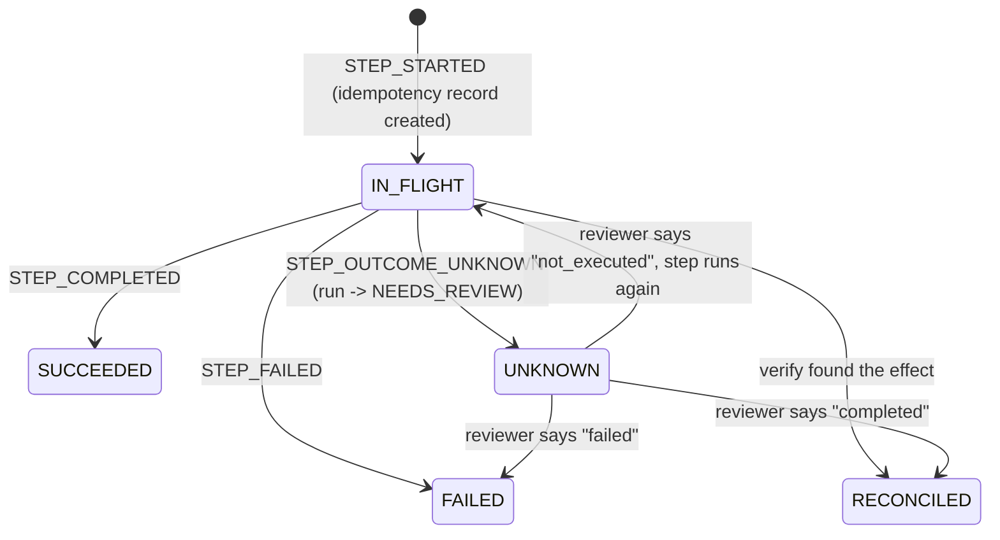

# Idempotency and external effects (Phase 3)

## The problem

A worker calls the payment service. The refund succeeds. The worker dies before it can write
`STEP_COMPLETED`. A new worker resumes the run and sees a step that started and never finished. Did
the refund happen? The runtime cannot know: a call to another system and a PostgreSQL commit are two
separate operations, and no protocol makes them atomic. (This is why "exactly-once" cannot be promised in
general.)

The runtime promises something weaker and honest: **at-least-once execution, with duplicate protection
wherever the external system supports it, and no blind retries where it does not.**

## Two kinds of step

| | `ctx.step` | `ctx.effect` |
|---|---|---|
| Use for | Reads, pure computation, anything safe to repeat | Payments, emails, any real-world side effect |
| Worker died mid-step | Runs again | Reconciled first (below) |
| Idempotency key | n/a | `<run_id>:<step_name>`, passed to the tool |

Wrapping a payment in plain `ctx.step` is a mistake and the tests show why: after a crash the step
runs again and the ledger shows two refunds (`test_wrapping_a_payment_in_a_plain_step_can_still_double_refund`).

## `ctx.effect` decision table

```python
refund = await ctx.effect("process_refund", payments.refund, order_id, amount, idempotent=True)
```

`idempotent=True` means the tool accepts an `idempotency_key` keyword argument and returns the original
result when it sees the same key again.

| Situation | idempotent=True | idempotent=False, `verify` given | idempotent=False, no `verify` |
|---|---|---|---|
| Worker died mid-call (step in doubt) | Call again with the **same key** | `verify(...)`: found → complete with that result; `None` → safe, call it; raises → unknown | `STEP_OUTCOME_UNKNOWN` |
| Tool raised `AmbiguousOutcomeError` (timeout, reply lost) | Retry with the same key, up to `max_attempts` (default 3) with backoff | Same as above, using `verify` | `STEP_OUTCOME_UNKNOWN`, no retry |
| Tool raised a definitive error (declined, refused) | `STEP_FAILED`, no retry | `STEP_FAILED` | `STEP_FAILED` |

## Lifecycle of an external operation



The `idempotency_records` row and its matching event are written in the same transaction, so the two can
never disagree. The record tracks what the *runtime* knows; the external system's own ledger is the
authority on what really happened.

## The review path (OUTCOME_UNKNOWN)

When a non-idempotent step's outcome cannot be established, the runtime stops instead of guessing:

1. Records `STEP_OUTCOME_UNKNOWN` (with the reason) and sets the run to `NEEDS_REVIEW`. Not `FAILED`, and
   nothing after that step runs.
2. `GET /runs?status=NEEDS_REVIEW` lists runs waiting for a person;
   `GET /runs/{id}/external-operations` shows the operation as `UNKNOWN`.
3. A person checks the external system and answers with
   `POST /runs/{id}/steps/{step}/resolve`:
   - `{"outcome": "completed", "result": {...}}` — it happened; use this result
   - `{"outcome": "failed", "message": "..."}` — it did not happen and must not be retried; the step fails
   - `{"outcome": "not_executed"}` — it did not happen; run it now
4. The answer is recorded as `STEP_RESOLVED` (with who decided), the run returns to `RUNNING`, and the run is resumed.

A "not executed" answer covers only the attempt right after it. If that attempt starts and the worker dies
again, the step is in doubt again and is reconciled again. (This was a real bug, see below.)

A reviewer is trusted: if they say "not executed" about a refund that did happen, it will run again.

## Verify hooks and references

A legacy provider that cannot dedupe can often still be *asked*. Give it a reference you choose:

```python
reference = ctx.idempotency_key("process_refund")
await ctx.effect("process_refund", legacy.refund, order_id, amount, reference,
                 idempotent=False, verify=lambda order_id, amount, reference: legacy.find_by_reference(reference))
```

`verify` receives the same arguments as the tool and returns the recorded result if the effect happened,
or `None` if it provably did not. (A result of `None` therefore cannot mean "found".)

## What is and is not protected

| Protected | Not protected |
|---|---|
| A retry or resume repeating a call whose tool honors the key | A tool that ignores or mishandles idempotency keys |
| A lost reply (timeout after the effect committed) | A second, separate run for the same order (keys are per run and step; a business rule like "refund each order once" belongs in the workflow) |
| A worker dying between the effect and recording it | Fencing tokens: they protect database writes only, not calls a stale worker makes to external APIs (Phase 4) |
| Blind retries of non-idempotent tools | A reviewer who gives a wrong answer |

## Where the tests prove it

The judge in every test below is the fake provider's own ledger, a separate database that the runtime does not touch.

| Scenario | Test | Result asserted |
|---|---|---|
| Refund succeeded, worker died before `STEP_COMPLETED` | `test_crash_after_the_refund_succeeds_still_leaves_exactly_one_refund` | 1 refund; same `refund_id` returned; record `SUCCEEDED`, attempts 2 |
| Same, with a real killed process | `test_refund_survives_a_kill_at_every_point...` (8 kill points) | always 1 refund and 1 email |
| Three workers die in a row | `test_three_workers_die_in_different_places...` | 1 refund, attempts 3 |
| Reply lost after commit | `test_a_lost_reply_is_retried_with_the_same_key...` | 1 refund |
| Request lost before commit | `test_a_request_lost_before_processing...` | 1 refund, 3 attempts |
| Payment declined | `test_a_declined_payment_fails_the_run...` | 0 refunds, run `FAILED` |
| Email fails after the refund | `test_email_failure_after_the_refund...` | refund stands, 0 emails, run `FAILED` |
| Non-idempotent, crash after the effect | `test_crash_after_a_non_idempotent_refund_is_not_retried...` | 1 refund, run `NEEDS_REVIEW` |
| Non-idempotent with verify | `test_verify_finds_the_refund_after_a_crash...` | 1 refund, `RECONCILED` |
| Reviewer resolves | `test_reviewer_confirms_...` (3 outcomes) | 1 refund, run completes or fails as decided |
| Random crash points and lost replies | `test_no_crash_pattern_can_duplicate_or_lose_a_payment` | exactly 1 refund per payment, run completes |

### A bug the property test found

The Hypothesis test generates random workflows (1-4 payments), provider kinds, crash points (before or
after the provider acts, on any payment, several times) and lost replies, and checks the ledger after every
step. It found a real defect in the first version of this phase:

1. Worker dies before calling the provider; the step is in doubt, so the run waits for review.
2. The reviewer checks the books, sees no refund, answers "not executed". Correct.
3. The cleared attempt runs, the provider refunds, and the worker dies again before recording it.
4. On resume the runtime still remembered the old "not executed" answer, skipped reconciliation and refunded
   **a second time**.

Fix: a new `STEP_STARTED` expires the reviewer's answer (`ReplayHistory`). Regression tests fail without the
fix (`test_regression_a_cleared_attempt_that_dies_again_is_reconciled_again` and a unit test). An earlier
failure from the same test was a wrong assumption in the test itself: a reviewer-confirmed step completes via
`STEP_RESOLVED`, not `STEP_COMPLETED`.

## Limitations

- Requires tools that honor `idempotency_key`, or a reference plus a verify hook, or a human.
- `AmbiguousOutcomeError` must be raised by the tool wrapper; the runtime cannot infer ambiguity from arbitrary exceptions.
- A step's result must be JSON and not `None` for `verify` to be able to signal "found".
- Retries inside one live attempt use a fixed small backoff (`retry_delay`); there is no configurable policy yet.
- Resuming is still triggered by a person or script; automatic recovery needs workers and leases (Phase 4).
