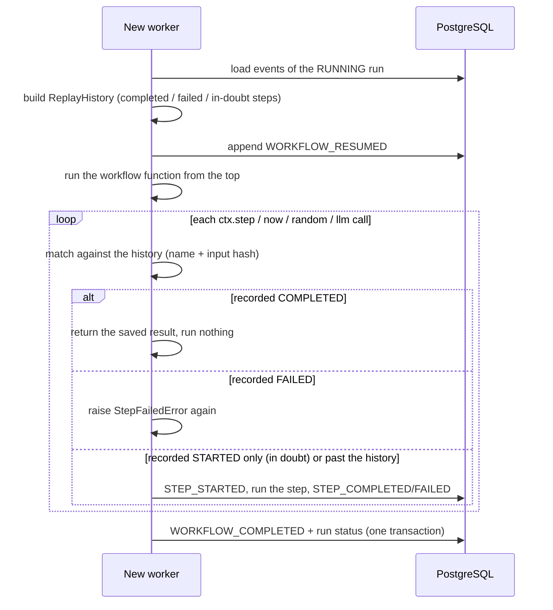

# Replay and recovery (Phase 2)

## The idea in one paragraph

Think of a video game with save points. Every time a step finishes, its result is saved in
PostgreSQL. If the worker dies, a new process loads the save, runs the workflow function again from
the top, and every step that already finished simply hands back its saved result instead of running.
Execution carries on live from the first step that has no saved result. That is *replay*.

## How `resume_run` works



## Divergence detection

Replay only works if the workflow makes the same calls in the same order as the recorded run.
Each call is checked against the history:

| Situation | Result |
|---|---|
| Step name differs from the one recorded at that position | `NonDeterminismError` |
| Same step, different input (e.g. refund `2000` recorded, `3000` now) | `NonDeterminismError` (inputs are compared by SHA-256 of canonical JSON) |
| Workflow returns before reaching recorded steps | `NonDeterminismError` |
| New steps after everything recorded | Allowed; they run live |
| Workflow code swallows the error (`except Exception`) and carries on | Every later `ctx` call re-raises it, so no further work is done |
| Registered workflow version differs from the run's | `WorkflowVersionMismatchError`, refused before anything runs |

A divergence is **not** treated as the workflow failing. The run stays `RUNNING` with no terminal
event, so you can fix or revert the code and resume again.

## What each crash leaves behind

Every row below is exercised by `tests/recovery/test_process_crash.py`, which kills a real worker
process at that exact point (failpoint) and resumes it in another process. The "ledger" is a file the
step functions append to, independent of the database.

| Crash point | Persisted at the crash | What the resuming worker does | Can a duplicate effect occur? |
|---|---|---|---|
| Before the first step (`after_workflow_started`) | `WORKFLOW_STARTED` | Empty history; runs every step live | No: nothing ran yet |
| Before `STEP_STARTED` (`before_step_started`) | Earlier steps completed | Replays them, runs this step live | No: the step never started |
| After `STEP_STARTED`, before the step ran (`after_step_started`) | `STEP_STARTED`, no outcome | Step is "in doubt": runs it again | No in this case, but the history cannot prove that (see next row) |
| **After the step's effect, before `STEP_COMPLETED` (`before_step_completed`)** | `STEP_STARTED`, no outcome; **the effect happened** | Indistinguishable from the row above. A plain `ctx.step` runs again; a `ctx.effect` is reconciled (same idempotency key, verify hook, or review) | **Plain `ctx.step`: yes** (ledger shows two refunds). **`ctx.effect`: no**, see [idempotency.md](idempotency.md) |
| Right after `STEP_COMPLETED` (`after_step_completed`) | The step's result | Replays it, continues with the next step | No |
| After the last step, before `WORKFLOW_COMPLETED` (`before_workflow_completed`) | All steps completed | Replays everything, records completion | No: nothing re-executes |
| Several workers die in a row | Whatever each one committed | Each resume re-runs only the step it died in | Only the in-doubt window above |

Other cases covered by tests:

- **Workflow input / code changes during replay:** `NonDeterminismError`, nothing executes, run stays `RUNNING`.
- **LLM call fails:** recorded as a failed step; the workflow sees `StepFailedError`; on replay the failure is raised again without calling the model.
- **LLM answered, worker died:** the recorded answer is reused. A re-run of the model could answer differently; replay never asks.
- **`ctx.now()` / `ctx.random()`:** the originally recorded instant and number are returned after a crash.

## Rules for writing replay-safe workflows

1. Anything with a side effect or external input goes inside `ctx.step(...)`.
2. Use `await ctx.now()`, `await ctx.random()` and `await ctx.llm(...)`. Never call `datetime.now()`,
   `random.random()` or an LLM SDK directly in the workflow body.
3. Do not branch on anything that can change between runs (environment, files, globals, the network)
   outside a step. If you must, read it inside a step so its value is recorded.
4. Call steps sequentially, and keep their order stable. Step names must be unique within a run;
   put the index in the name inside loops. (Concurrent steps via `asyncio.gather` are not supported.)
5. Handle step failures with `except StepFailedError`, the only type a step failure ever raises,
   on the first run and on every replay.
6. When you change workflow logic, bump `@workflow(version=...)`. Runs started under the old version
   can no longer be resumed by the new code.
7. Step arguments and results must be JSON-serializable. Results are round-tripped through JSON so
   that the first run and a replay hand the workflow identical values (a tuple becomes a list both times).

## Recorded values

`ctx.llm(name, prompt=..., model=...)` stores, as the step's result: output, model, SHA-256 of the
prompt (not the prompt itself), input and output tokens, estimated cost in USD, latency in ms and a
timestamp. Cost is `null` unless per-token prices are configured; the runtime never guesses.
`ctx.now()` and `ctx.random()` are stored under the step names `__now_1`, `__random_1`, and so on.

## Failpoints

`DURABLE_FAILPOINT=<name>[:<step>]` makes the process exit immediately (code 77, no cleanup) at
that point. Names: `after_workflow_started`, `before_step_started`, `after_step_started`,
`before_step_completed`, `after_step_completed`, `before_workflow_completed`. With the variable
unset, which is always the case in normal operation, nothing happens.

## Limitations (honest list)

- **At-least-once, not exactly-once.** A plain `ctx.step` in the in-doubt window runs again, so it must
  be repeat-safe. Calls with side effects use `ctx.effect` (Phase 3: idempotency keys, verify hooks,
  `OUTCOME_UNKNOWN`), which is only as safe as the external system allows.
- **Direct `resume_run` still needs a dead executor.** Called by a person or script, it must only be used
  when the old executor is known to be dead. Worker processes (Phase 4) make recovery automatic and safe:
  a worker takes over a run only after its lease expires, and fencing tokens reject the old executor's
  writes if it was merely slow. See [workers-and-leases.md](workers-and-leases.md).
- Replay re-runs the whole workflow function, so very long histories cost time (no snapshots yet).
- Sequential steps only.
- JSONB does not preserve object key order, so a replayed object may list keys differently.

## Try it

```bash
python scripts/demo_crash_recovery.py            # kills a worker, resumes in a new process
pytest -m recovery                               # all crash/resume tests
python -m app.engine.runner resume <run_id>      # resume one run by hand
python -m app.engine.worker --drain              # or let a worker recover it (waits for the lease)
```
