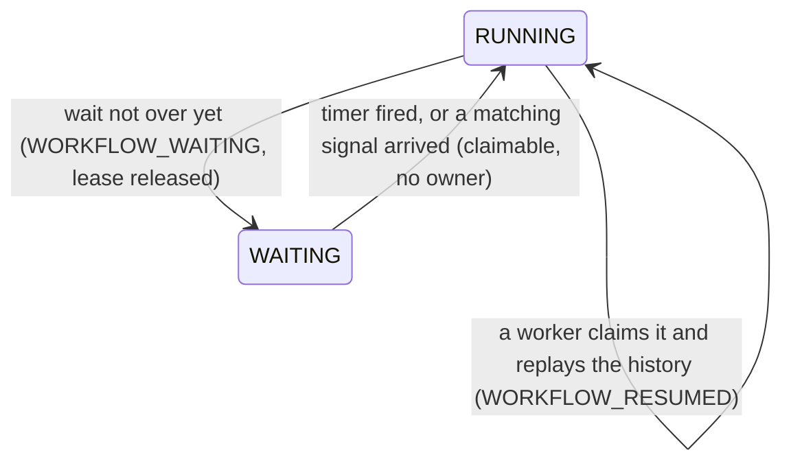

# Durable timers and signals (Phase 5)

A workflow can wait for a duration (`ctx.sleep`) or for a message from outside (`ctx.wait_for_signal`),
for seconds or for days, **without holding a process, a connection or a lease**.

```python
@workflow
async def leave_approval(ctx, employee, manager, days):
    await ctx.effect("email_manager", send, manager, ..., idempotent=True)
    answer = await ctx.wait_for_signal("await_decision", signal="manager_decision", timeout=3 * 24 * 3600)
    if not answer["received"]:                       # nobody answered in 3 days
        await ctx.effect("escalate", send, ..., idempotent=True)
        ...
```

## The model

A wait is a normal recorded step (`STEP_STARTED` ... `STEP_COMPLETED`) with one difference: between the
two the run can be **parked**.



| Piece | Where it lives |
|---|---|
| Deadline of a `sleep` / timeout | `workflow_timers.fire_at`, computed once from the **database clock** |
| Signals | `workflow_signals` (stored on arrival, consumed once by a wait) |
| "Which signal wakes this run" | `workflow_runs.waiting_signal` |
| The wait's result | the `STEP_COMPLETED` event, so a replay returns the same answer |

## How a wait is evaluated (one transaction, run row locked)

1. Create the timer if the wait has a duration (`ON CONFLICT DO NOTHING`: a replay finds the existing row,
   so the deadline never moves).
2. Signal wait: if an unconsumed signal with that name exists, consume the **oldest** one, cancel the timer,
   record `STEP_COMPLETED {received: true, payload, signal_id}`.
3. Else if the timer is due: mark it `FIRED`, record `{received: false, timed_out: true}` (or, for a sleep,
   `{fire_at}`).
4. Else park: append `WORKFLOW_WAITING`, set the run `WAITING`, clear the lease.

**A signal that is already stored beats a timeout that is also due.** Both are checked in this order.

## Why no wakeup is lost

`send_signal`, the timer firer and the wait evaluation all take the **run's row lock** first. So either the
signal commits before the wait looks (the wait finds it and completes), or the wait commits `WAITING`
first (the signal then sees `WAITING` and wakes the run). There is no interleaving in which the signal
arrives "between" the check and the park. `tests/concurrency/test_waits_concurrency.py` races them 30 times.

## Waking

- **Signal:** `POST /runs/{id}/signals/{name}` stores it and, if the run is `WAITING` for that name, makes the
  run claimable (`RUNNING`, no owner, expired lease) in the same transaction. A signal with another name is
  stored but does not wake the run. Signals can arrive early (before the run reaches the wait).
- **Timer:** every worker poll calls `fire_due_timers()`. Each due timer is locked with `FOR UPDATE SKIP LOCKED`
  and re-checked under the lock, so 12 concurrent callers fire 8 timers exactly 8 times.
  Lock order is run row, then timer row, everywhere, so the two paths cannot deadlock.
- Any worker then claims the woken run through the normal claim path and replays it. Replay returns the
  recorded results of earlier steps and re-evaluates the wait (spurious wakes are harmless: it parks again
  with the same timer).

## Idempotency of signals

`idempotency_key` is unique per run. The same key delivered twice returns the original receipt
(`200`, `duplicate: true`) and stores nothing. Signals without a key are not deduplicated (two sends are two
signals). Sending to a `COMPLETED` or `FAILED` run is `409`; an unknown run is `404`.

## Failure table

| Failure | State on disk | Outcome |
|---|---|---|
| Worker killed right after parking the run | `WAITING`, no lease | Signal or timer wakes it; any worker finishes; each step ran once |
| Worker killed before the wait was evaluated | `RUNNING`, lease held | Lease expires, takeover evaluates the wait, parks; no second `STEP_STARTED` |
| Worker killed right after consuming the signal | `STEP_COMPLETED` recorded | Takeover replays it: the signal is consumed once |
| Signal delivered twice | one `workflow_signals` row | second call is a no-op |
| Signal races the park | serialised by the row lock | run always ends `COMPLETED`, signal consumed once |
| Two workers fire the same timer | `SKIP LOCKED` | fired once |
| Timer fires after a signal already woke the run | timer marked `FIRED`, run not woken again | harmless |

## Limits (stated plainly)

- Timer accuracy is the worker poll interval (default 1 s) plus claim time. This is not a high-precision scheduler.
- `EXECUTION_MODE=inline` has no workers, so nothing fires timers there; signals still wake runs (resumed in the
  API process). Use `EXECUTION_MODE=workers` for sleeps and timeouts.
- `--drain` workers wait for pending timers of waiting runs, but not for signal waits without a timeout (no
  worker can advance those).
- Workflow code must not call `asyncio.sleep` for long waits; use `ctx.sleep` so the wait is durable.
- Signals are not an event type in the history; their receipt time and consumer are in `workflow_signals`,
  their consumption in the wait step's `STEP_COMPLETED`.
