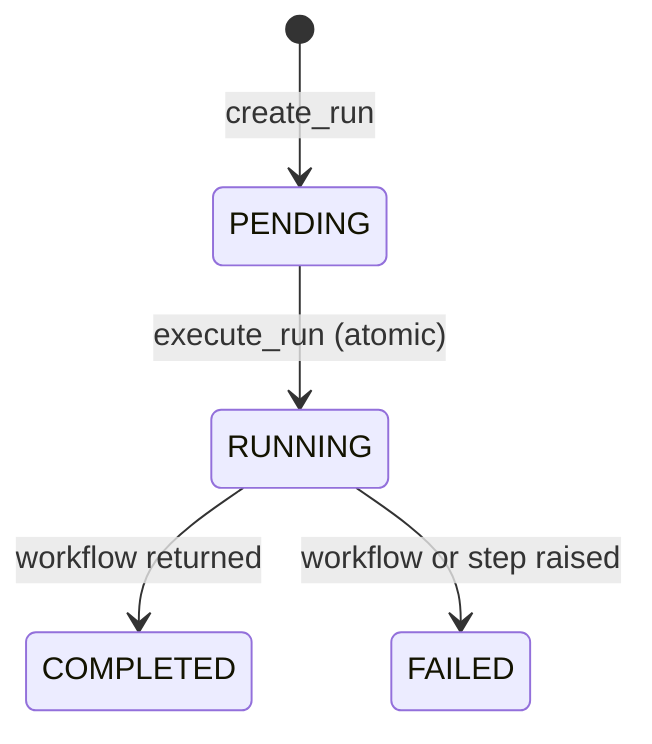
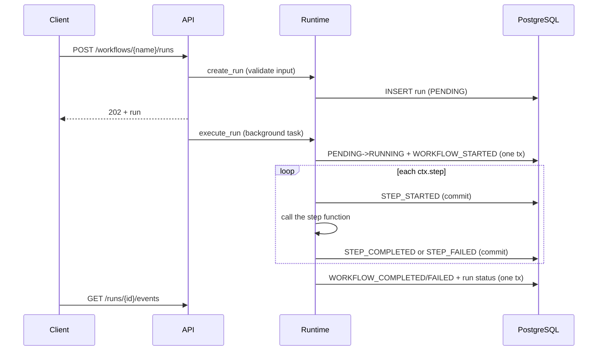

# Workflow lifecycle (Phase 1)

## Run states

`WAITING` and `CANCELLED` arrive with timers, signals and cancellation in later phases.

## What happens for one run

## Event types

| Event | When |
|---|---|
| `WORKFLOW_STARTED` | The run moved from PENDING to RUNNING |
| `STEP_STARTED` | Before the step function is called; carries the input hash |
| `STEP_COMPLETED` | The step returned; carries the JSON result |
| `STEP_FAILED` | The step raised; carries error type and message (no stack trace) |
| `WORKFLOW_COMPLETED` / `WORKFLOW_FAILED` | The workflow function returned or raised |

## Rules for workflow authors

- Define workflows with `async def`; the first parameter is the context, the rest come from the run input.
- Arguments and results of `ctx.step` must be JSON-serializable.
- Step names must be unique within a run; in a loop use `f"fetch_{i}"`.
- Put anything with side effects or nondeterminism inside a step, never directly in the workflow body.
  Replay (Phase 2) will re-run the workflow body, so only steps are safe to skip.

## Current limitations (honest list)

- No replay: a crash mid-run leaves the run `RUNNING`; it is not resumed yet. (Phase 2)
- Execution runs inside the API process, not in worker processes. (Phase 4)
- A step that is `STEP_STARTED` with no outcome after a crash cannot be reconciled yet. (Phase 3)
- Failed steps are not retried; there are no retry limits or backoff yet.
