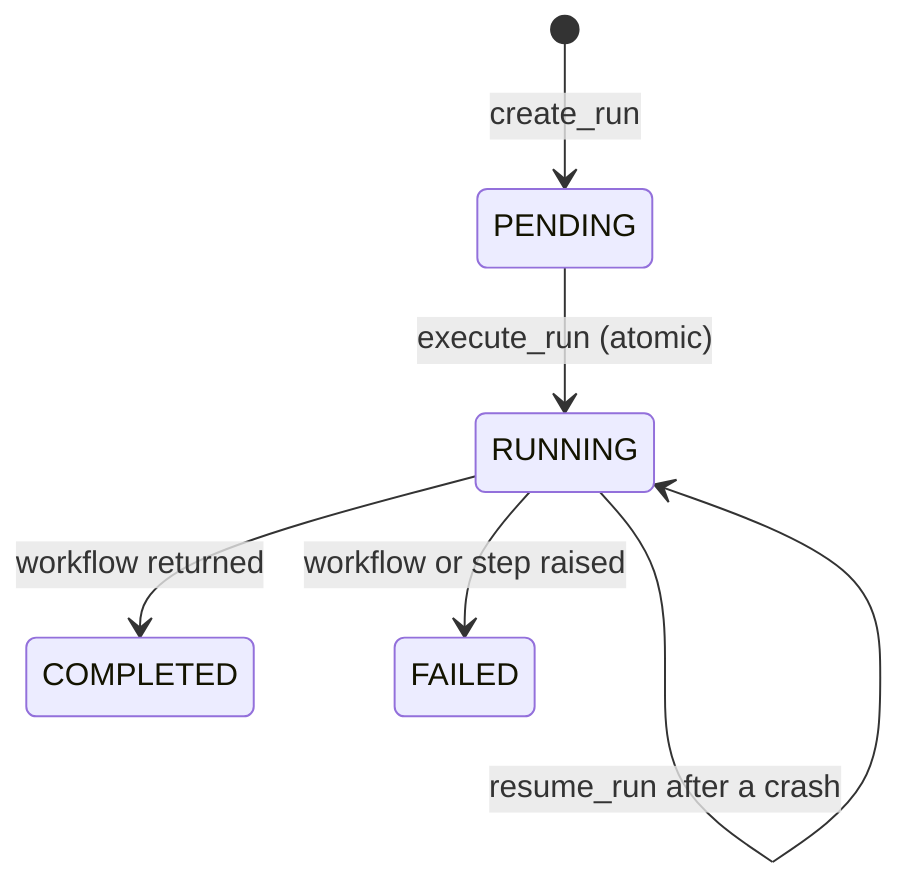
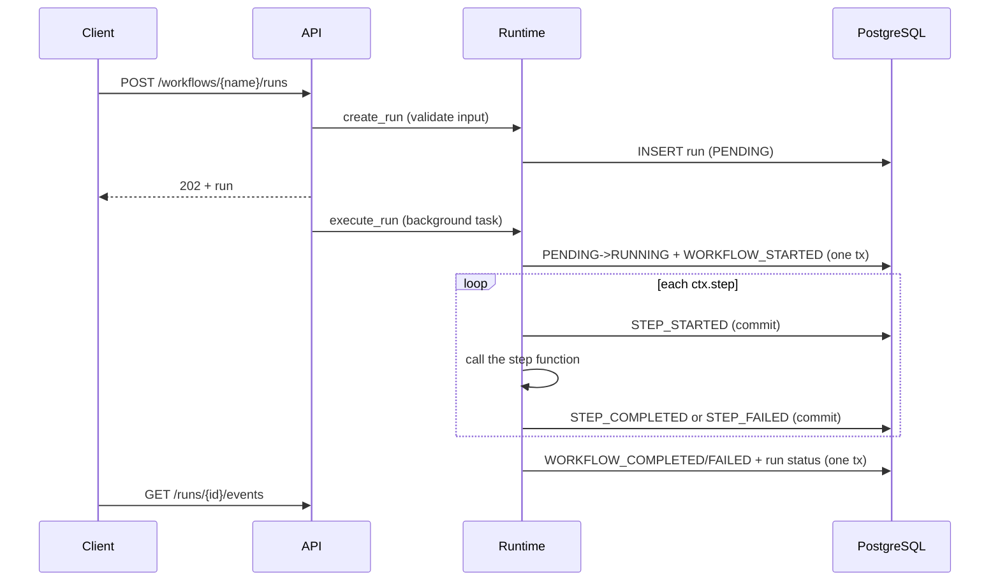

# Workflow lifecycle (Phase 1)

## Run states

`WAITING` and `CANCELLED` arrive with timers, signals and cancellation in later phases.

## What happens for one run

## Event types

| Event | When |
|---|---|
| `WORKFLOW_STARTED` | The run moved from PENDING to RUNNING |
| `WORKFLOW_RESUMED` | `resume_run` started replaying a crashed run; carries counts of completed, failed and in-doubt steps |
| `STEP_STARTED` | Before the step function is called; carries the input hash |
| `STEP_COMPLETED` | The step returned; carries the JSON result |
| `STEP_FAILED` | The step raised; carries error type and message (no stack trace) |
| `WORKFLOW_COMPLETED` / `WORKFLOW_FAILED` | The workflow function returned or raised |

## Rules for workflow authors

- Define workflows with `async def`; the first parameter is the context, the rest come from the run input.
- Arguments and results of `ctx.step` must be JSON-serializable.
- Step names must be unique within a run; in a loop use `f"fetch_{i}"`.
- Put anything with side effects or nondeterminism inside a step, never directly in the workflow body.
  Use `await ctx.now()`, `await ctx.random()` and `await ctx.llm(...)` for time, randomness and models.
- Handle step failures with `except StepFailedError`.

The full list, with the reasons, is in [replay-and-recovery.md](replay-and-recovery.md).

## Current limitations (honest list)

- A step with an external side effect can run twice if the worker dies between the effect and
  `STEP_STARTED`'s outcome being recorded; idempotency fixes this in Phase 3.
- Nothing resumes crashed runs automatically, and `resume_run` is only safe when the old executor is
  dead. Worker processes, leases and fencing are Phase 4.
- Execution runs inside the API process, not in worker processes. (Phase 4)
- Failed steps are not retried; there are no retry limits or backoff yet.
